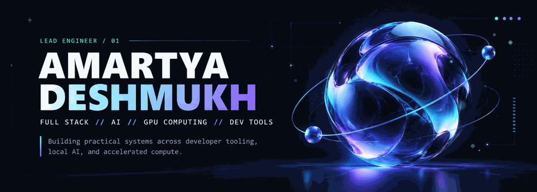

  

**Lead Engineer** building practical products at the intersection of full-stack development, AI/ML, GPU computing, and developer tooling. I focus on systems that are useful, measurable, and built to ship.

## `01 / FOCUS`

- **Product engineering** — web, desktop, APIs, and maintainable software architecture.
- **AI systems** — local inference, model training, and agent workflows.
- **GPU acceleration** — image/video pipelines and native runtime integrations.

## `02 / TOOLCHAIN`

**Languages:** `C#` · `Python` · `TypeScript` · `JavaScript` · `SQL`  
**Apps:** `.NET` · `ASP.NET` · `Angular` · `React` · `Node.js` · `Tauri` · `Electron`  
**AI + GPU:** `PyTorch` · `CUDA` · `OpenCV` · `ONNX Runtime` · `FFmpeg` · `ComfyUI`  
**Data + Cloud:** `SQL Server` · `SQLite` · `Azure` · `Docker` · `GitHub Actions`

## `03 / FEATURED BUILDS`

### [ComfyUI NVIDIA DLSS 5 Visual Enhancer](https://github.com/Konohamaru04/ComfyUI-NVIDIA-DLSS-Frame-Interpolation)
Native NVIDIA DLSS processing for ComfyUI: frame interpolation, video/image upscaling, GPU runtime integration, encoding, and diagnostics.

`Python` · `NVIDIA DLSS` · `ComfyUI` · `FFmpeg`

### [Tiny-LLM](https://github.com/Konohamaru04/Tiny-LLM)
A GPT-style language model built in PyTorch, from BPE tokenization and pretraining through fine-tuning, evaluation, and local inference.

`PyTorch` · `Transformers` · `BPE` · `CUDA`

### [Computer-Use-Agent](https://github.com/Konohamaru04/Computer-Use-Agent)
A local desktop agent for Ollama vision models, with a Tauri + React UI and a bounded **observe → plan → act → verify** execution loop.

`Python` · `Tauri` · `React` · `Ollama` · `MCP`

## `04 / ENGINEERING SIGNAL`

**Approach:** model the contract · isolate the bottleneck · measure the result · ship maintainable software.

More projects and experiments → **[Explore my repositories](https://github.com/Konohamaru04?tab=repositories)**

AMARTYA DESHMUKH · LEAD ENGINEER · BUILT WITH INTENT

